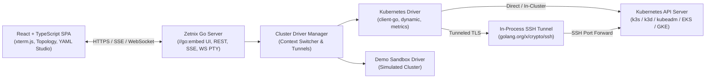

# ⚡ Zetnix

**A lightweight, OpenShift-inspired Kubernetes web console built with Go (`k8s.io/client-go`) and React/TypeScript.**

Zetnix compiles the entire React frontend and Go control-plane backend into a **single binary** (`//go:embed`) or minimal container image (~25 MB compressed), consuming ~15–30 MB RAM at runtime. It is designed to run cleanly on single-node VPS clusters (`k3s`, `k3d`, `kubeadm`, `microk8s`) as well as multi-node production environments.

[](#)
[](#)
[](#)
[](LICENSE)

---

## Features

- **Dual Perspectives (`Platform` & `Developer`)**: Switch between cluster administration (Command Center, Nodes & Compute, Events, Storage) and application workflows (Topology Mesh, Developer Catalog, Deployments, Routes). Switching to **Developer** automatically scopes out system namespaces just like OpenShift.
- **OpenShift-Style Project Scoping**: Cleanly separates **Your Projects** from **System Namespaces** (`kube-system`, `kube-public`, `kube-node-lease`), includes a one-click **`Hide kube-*`** filter toggle, inline project/namespace creation, and smart default namespace targeting across YAML templates.
- **Interactive Topology Mesh**: Pan, zoom, drag, and auto fit-to-screen across application topology graphs grouping Ingresses → Services → Workloads (Deployments, StatefulSets, DaemonSets, Jobs, CronJobs) & standalone Pods → PVCs with layer filters, live replica rings, and Pod status dots.
- **Command Center & Incident Diagnostics**: Radial health index gauge, live CPU & Memory telemetry sparklines, Pod phase distribution bar, actionable diagnostic alert banner jumping straight to failing Pod logs (`CrashLoopBackOff`, `ImagePullBackOff`, `Failed`), and quick-filter tables (**Issues Only**).
- **Rich Resource Inspector Drawer**: Dedicated detail panels for Pods (containers, node jump link, parent workload link), Workloads (scale `+/-`, rollout restart, managed Pods), Nodes (host/runtime info, conditions, scheduled Pods), Services (port mappings, selectors, endpoints), Ingresses (TLS & routing rules), ConfigMaps (copyable values), Secrets (masked metadata), and PVCs.
- **Real-Time Sync & Single-Shot Snapshot**: Consolidated `/api/v1/snapshot` payload paired with Kubernetes Watch over Server-Sent Events (`/api/v1/watch`) so Pod and Deployment transitions update automatically without manual refresh.
- **Live Log Streaming (`SSE`)**: Stream container logs in real time with container selector, tail length (`100` / `250` / `1000`), grep search, line wrapping, pause/follow, and `.log` export.
- **Interactive Web Terminal (`xterm.js` + WebSocket PTY)**: Attach an interactive `/bin/sh` or `/bin/bash` session directly into any running container via `k8s.io/client-go` SPDY `remotecommand` with dynamic PTY resize and proxy keepalive pings.
- **Multi-Document YAML Studio, App Catalog & Quick Creators**: Client-side YAML syntax validation (`js-yaml`), auto-formatting, live resource YAML inspection/editing, multi-document apply (`---`), Developer Catalog stacks, and contextual **`+ New PVC`**, **`+ New ConfigMap`**, and **`+ New Secret`** buttons.
- **Command Palette (`⌘K` / `Ctrl+K`) & Dual Themes**: Instant Spotlight search across views, workloads, pods, and services, with Obsidian Dark and Daylight Light themes.
- **In-UI Multi-Cluster Setup**:
  - **VPS SSH Auto-Tunnel**: Pure-Go (`golang.org/x/crypto/ssh`) SSH tunnel that automatically discovers and reads the remote kubeconfig (`~/.kube/config`, `k3s.yaml`, `rke2.yaml`, `admin.conf`, `k0s`, `microk8s`) and forwards the Kubernetes API locally in memory.
  - **Kubeconfig File / YAML**: Switch contexts from `~/.kube/config`, upload a `.yaml`/`config` file, or paste kubeconfig YAML in memory.
  - **API URL + Token**: Connect directly using a Kubernetes API endpoint and ServiceAccount Bearer Token.
  - **Built-in Demo Sandbox (`--demo`)**: Self-contained interactive Kubernetes simulator with realistic metrics, live logs, simulated container shell, and a Chaos trigger for testing or demos without a cluster.
- **Optional Built-in Authentication**: Protect public VPS deployments with `--auth-pass` / `ZETNIX_AUTH_PASS` (HMAC-SHA256 `HttpOnly` session cookies + login screen).

---

## Architecture



---

## Quick Start

### Prerequisites

- **Go** `1.26+` (for building from source)
- **Node.js** `20+` & **npm** (for building the React frontend)
- *(Optional)* **Docker** for building container images

### 1. Build & Run Locally

```bash
git clone https://github.com/<your-username>/zetnix.git
cd zetnix

make build
./bin/zetnix --addr :8080
```

Open `http://localhost:8080`.

#### Automatic Cluster Discovery Order
Unless `--demo` or `--kubeconfig` is specified explicitly, Zetnix automatically checks for a local cluster on startup in this order:
1. **In-Cluster (`ServiceAccount`)** — when running inside a Kubernetes Pod.
2. **Readable Kubeconfig** — checks `$KUBECONFIG`, `~/.kube/config`, `/etc/rancher/k3s/k3s.yaml`, `/etc/rancher/rke2/rke2.yaml`, and `/etc/kubernetes/admin.conf` in order.
3. **Demo Sandbox Mode** — automatic fallback when no cluster config is present or readable.

### 2. Run with Docker

```bash
docker build -t zetnix:1.0.0 .
docker run --rm -p 8080:8080 zetnix:1.0.0 --demo
```

To mount your local kubeconfig into the container:

```bash
docker run --rm -p 8080:8080 \
  -v ~/.kube/config:/home/zetnix/.kube/config:ro \
  -e KUBECONFIG=/home/zetnix/.kube/config \
  zetnix:1.0.0
```

---

## Deploying on a VPS / Production

Running Zetnix directly on the same VPS or inside the Kubernetes cluster eliminates SSH tunnel latency and gives sub-10ms API response times. Because Zetnix automatically discovers local kubeconfigs on startup, pulling and running it on a server with an existing Kubernetes cluster (`k3s`, `k3d`, `rke2`, or `kubeadm`) works out of the box.

### Pull & Build Directly on the VPS

- **Without installing Go/Node.js on the host** (uses multi-stage Docker build):
  ```bash
  git clone https://github.com/<your-username>/zetnix.git
  cd zetnix
  docker build -t zetnix:1.0.0 .
  ```
- **Or compile natively on the VPS** (requires Node.js `20+` and Go `1.26+`):
  ```bash
  git pull
  make build
  ZETNIX_AUTH_USER=admin ZETNIX_AUTH_PASS="replace-with-a-strong-password" \
    ./bin/zetnix --addr 127.0.0.1:9090
  ```

### Option A: Single Binary on Linux VPS + HTTPS Reverse Proxy

Cross-compile the static Linux binary (`amd64`) with the embedded UI:

```bash
make cross-linux
```

Copy `bin/zetnix-linux-amd64` to your VPS and bind it to loopback (`127.0.0.1`) with authentication enabled:

```bash
sudo install -m 0755 zetnix-linux-amd64 /usr/local/bin/zetnix

ZETNIX_AUTH_USER=admin \
ZETNIX_AUTH_PASS="replace-with-a-strong-password" \
ZETNIX_ALLOW_KUBECONFIG_UPLOAD=false \
  /usr/local/bin/zetnix --addr 127.0.0.1:9090 --kubeconfig /root/.kube/config
```

Example **systemd** unit (`/etc/systemd/system/zetnix.service`):

```ini
[Unit]
Description=Zetnix Kubernetes Control Plane
After=network.target

[Service]
Type=simple
Environment=ZETNIX_ADDR=127.0.0.1:9090
Environment=ZETNIX_KUBECONFIG=/root/.kube/config
Environment=ZETNIX_AUTH_USER=admin
Environment=ZETNIX_AUTH_PASS=replace-with-a-strong-password
Environment=ZETNIX_ALLOW_KUBECONFIG_UPLOAD=false
ExecStart=/usr/local/bin/zetnix
Restart=always
RestartSec=3

[Install]
WantedBy=multi-user.target
```

Then front `127.0.0.1:9090` with **Caddy** (`/etc/caddy/Caddyfile`) for automatic HTTPS, SSE, and WebSocket support:

```caddyfile
zetnix.example.com {
    reverse_proxy 127.0.0.1:9090
}
```

### Option B: Deploy In-Cluster (`k3s` / `k3d` / `kubeadm`)

1. Build the image (and import it if using `k3d`):
   ```bash
   docker build -t zetnix:1.0.0 .
   # For k3d:
   k3d image import zetnix:1.0.0 -c <your-cluster-name>
   ```
2. Update the `password` inside `zetnix-auth` in [`deploy/k8s/zetnix.yaml`](deploy/k8s/zetnix.yaml), and optionally uncomment the `Ingress` block at the bottom of the manifest.
3. Apply to your cluster:
   ```bash
   kubectl apply -f deploy/k8s/zetnix.yaml
   ```
4. Access via port-forward or your Ingress domain:
   ```bash
   kubectl -n zetnix-system port-forward svc/zetnix 8080:80
   ```

### Option C: Connect Remotely via Built-in SSH Auto-Tunnel

1. Run `./bin/zetnix --addr :8080` on your workstation.
2. Open the **Cluster Connections** modal in the top bar → **VPS SSH Auto-Tunnel**.
3. Enter your VPS IP/hostname, SSH port, username, and SSH key (or password).
4. Zetnix establishes an in-process encrypted SSH tunnel, locates your remote kubeconfig automatically, and switches the console to your cluster.

---

## Configuration Reference

All CLI flags have corresponding environment variables:

| CLI Flag | Environment Variable | Default | Description |
|---|---|---|---|
| `--addr` | `ZETNIX_ADDR` | `:8080` | HTTP listen address |
| `--kubeconfig` | `KUBECONFIG` | `auto` | Path to kubeconfig file (auto-discovers `~/.kube/config`, `k3s.yaml`, `rke2.yaml`, `admin.conf`, or falls back to in-cluster / Demo mode) |
| `--context` | `ZETNIX_CONTEXT` | `""` | Initial kubeconfig context override |
| `--demo` | `ZETNIX_DEMO` | `false` | Force built-in interactive Demo Sandbox Cluster |
| `--allow-kubeconfig-upload` | `ZETNIX_ALLOW_KUBECONFIG_UPLOAD` | `true` | Allow connecting clusters via UI (SSH/Kubeconfig/Token) |
| `--cluster-name` | `ZETNIX_CLUSTER_NAME` | `""` | Custom display label for the initial cluster |
| `--static-dir` | `ZETNIX_STATIC_DIR` | `""` | Serve UI assets from disk instead of embedded bundle |
| `--auth-user` | `ZETNIX_AUTH_USER` | `admin` | Username when built-in login protection is enabled |
| `--auth-pass` | `ZETNIX_AUTH_PASS` | `""` | Password/token protecting API & UI (disabled when empty) |

---

## API Overview

| Method & Path | Purpose |
|---|---|
| `GET /api/v1/health` | Health check and Zetnix version |
| `GET /api/v1/auth/status` | Check whether login gate is active |
| `POST /api/v1/auth/login` | Issue `HttpOnly` HMAC-signed session cookie |
| `POST /api/v1/auth/logout` | Clear session cookie |
| `GET /api/v1/snapshot?namespace=...` | Consolidated cluster snapshot (nodes, pods, workloads, topology, overview, events) |
| `GET /api/v1/cluster` | Active cluster status and available contexts |
| `POST /api/v1/cluster/switch` | Switch active cluster context |
| `POST /api/v1/cluster/connect` | Connect via uploaded kubeconfig YAML |
| `POST /api/v1/cluster/connect-ssh` | Connect via in-process SSH tunnel + remote kubeconfig discovery |
| `POST /api/v1/cluster/connect-token` | Connect via Kubernetes API URL + Bearer Token |
| `POST /api/v1/cluster/disconnect` | Close and remove a dynamic cluster/tunnel |
| `GET /api/v1/watch?namespace=...` | Real-time SSE stream for Pod, Deployment, and Event updates |
| `GET /api/v1/pods/{ns}/{pod}/logs` | Real-time SSE container log stream |
| `GET /api/v1/pods/{ns}/{pod}/exec` | WebSocket PTY container terminal |
| `GET /api/v1/yaml` & `POST /api/v1/yaml/apply` | Fetch resource YAML and apply multi-document manifests |
| `POST /api/v1/workloads/scale` & `restart` | Scale replicas or trigger rolling restarts |

---

## Development & Testing

Run the Go backend API and Vite HMR frontend side by side during development:

```bash
# Terminal 1 — Go API (Demo Sandbox mode)
make dev-api

# Terminal 2 — Vite HMR dev server (http://localhost:5173)
make dev-ui
```

Run tests and production builds:

```bash
# Frontend type-check + Vite build
npm --prefix web run build

# Backend unit & HTTP handler tests
go test -count=1 -v ./...

# Full single-binary build
make build
```

---

## Security Notes

- Uploaded kubeconfigs, SSH passwords/private keys, and Bearer tokens used in dynamic cluster connections are kept **in memory only** and are never written to disk.
- When exposing Zetnix beyond localhost, always set `ZETNIX_AUTH_PASS` (or place Zetnix behind an authenticating HTTPS reverse proxy) and consider setting `ZETNIX_ALLOW_KUBECONFIG_UPLOAD=false` if only the cluster's ServiceAccount/kubeconfig should be accessible.
- Review [`deploy/k8s/zetnix.yaml`](deploy/k8s/zetnix.yaml) RBAC scope (`ClusterRole`) before deploying to multi-tenant clusters and tighten permissions to least privilege where needed.

---

## Contributing

Contributions, bug reports, and feature ideas are welcome. Please read [CONTRIBUTING.md](CONTRIBUTING.md) before opening a pull request.

## License

Licensed under the [Apache License 2.0](LICENSE).
